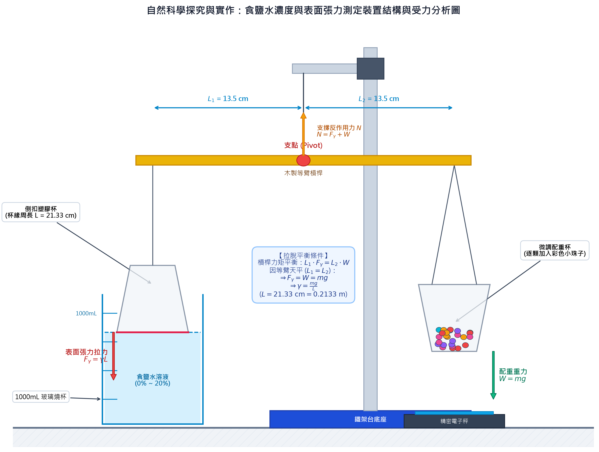
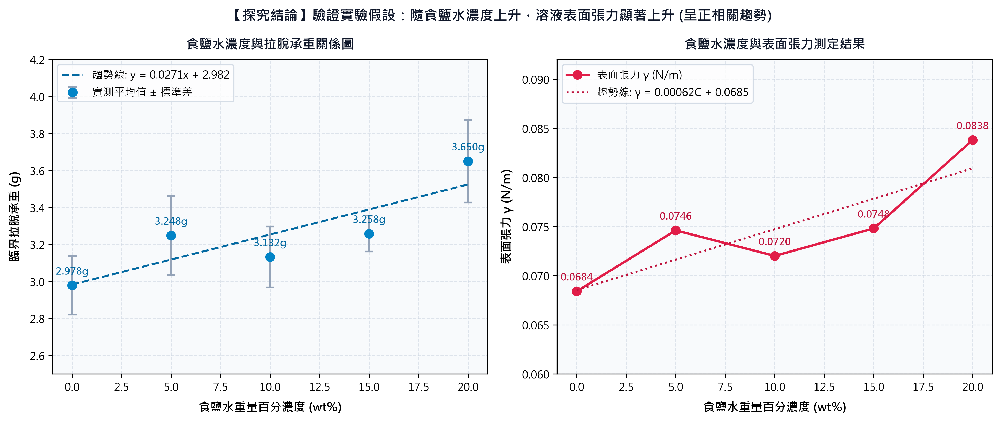

# 🧪 食鹽水表面張力測定裝置 3D 互動模型與探究分析系統

基於**拉脫法（Detachment Method）**之自然科學探究與實作實驗裝置 3D 數位孿生模型與物理模擬系統。

## 🌐 線上展示 (GitHub Pages)
👉 **[點此進入 3D 線上互動檢視器](https://kcy3f0.github.io/surface-tension-3d/)**

---

## 📷 裝置結構與受力分析

## 📊 食鹽水濃度與表面張力測定數據

---

## 🔬 物理原理與計算公式
- **槓桿力矩平衡**：$L_1 \cdot F_\gamma = L_2 \cdot W$
- 因採用等臂天平（$L_1 = L_2 = 13.5\text{ cm}$）：
  $$F_\gamma = W = m_{\text{珠}} \cdot g$$
- **表面張力計算公式**：
  $$\gamma = \frac{F_\gamma}{L} = \frac{m_{\text{珠}} \cdot g}{L}$$
  * $L = 21.33\text{ cm} = 0.2133\text{ m}$（塑膠杯緣接觸周長）
  * $g = 9.80\text{ m/s}^2$（重力加速度）
  * $m_{\text{珠}}$：拉脫瞬間右側杯中珠子總重量

---

## 📁 檔案說明
- `index.html`：3D WebGL 互動模擬器主頁面。
- `surface_tension_apparatus.glb`：可直接匯入 PowerPoint 3D 進行 360° 簡報旋轉展示的 3D 模型。
- `surface_tension_apparatus.obj` / `.mtl`：通用 3D CAD 模型（支援 Blender、Maya、AutoCAD）。
- `libs/`：Three.js 核心及 OrbitControls、GLTFExporter、OBJExporter 本地相依庫。
